# [springboot]Java大学生创新能力培养平台的设计

> 🎓 **计算机毕业设计 · [springboot]Java大学生创新能力培养平台的设计**
>
> 本仓库只放**项目介绍 + 运行截图**（截图是站点带水印的原图，存在仓库 `images/` 里）。
>
> 👉 **完整可运行源码 / 数据库脚本 / 部署文档：[点我获取](https://geekcode.top/archives/springboot-Java%E5%A4%A7%E5%AD%A6%E7%94%9F%E5%88%9B%E6%96%B0%E8%83%BD%E5%8A%9B%E5%9F%B9%E5%85%BB%E5%B9%B3%E5%8F%B0%E7%9A%84%E8%AE%BE%E8%AE%A1?utm_source=github)**
>
> 💬 咨询微信：**ir9372**　|　🌐 更多项目：[极客代码 geekcode.top](https://geekcode.top/?utm_source=github)
>
> 📌 项目详情页：<https://geekcode.top/archives/springboot-Java%E5%A4%A7%E5%AD%A6%E7%94%9F%E5%88%9B%E6%96%B0%E8%83%BD%E5%8A%9B%E5%9F%B9%E5%85%BB%E5%B9%B3%E5%8F%B0%E7%9A%84%E8%AE%BE%E8%AE%A1?utm_source=github>

<table><td width="230" align="center"> <b>扫码加微信 ir9372</b></td><td valign="middle">📦 源码 = 项目介绍 + 全部运行截图 + 数据库 + 部署文档 👉 点上方任意截图，直接跳到 <b>极客代码 geekcode.top</b> 详情页</td></table>

---

<h1>[springboot]Java大学生创新能力培养平台的设计</h1>
<h2>项目概述</h2>

本项目旨在构建一个面向高校学生的 Java 大学生创新能力培养平台，致力于提升大学生的创新思维、实践能力及团队协作水平。平台通过整合讲座信息、创新思维培养课程、创新能力比赛报名、团队项目申报及评审反馈等核心业务流程，为师生提供一站式服务。适用人群主要包括在校大学生、指导教师及系统管理员。技术架构采用前后端分离模式，后端基于 Spring Boot 框架结合 MyBatis-Plus 进行数据持久化，使用 Shiro 实现安全权限控制；前端采用 Vue 框架构建用户界面。该平台有效解决了传统线下活动管理效率低、信息分散的问题，实现了创新教育资源的数字化与流程化管理。

<h2>技术架构</h2>

本平台采用经典的前后端分离架构设计，确保了系统的可维护性与扩展性。

<strong>1. 后端架构</strong>
后端核心基于 <strong>Spring Boot</strong> 框架，利用其自动配置特性快速搭建应用环境。数据访问层选用 <strong>MyBatis-Plus</strong>，在 MyBatis 的基础上提供了 CRUD 方法增强及分页插件，显著减少了样板代码的编写。数据库连接池使用 <strong>spring-boot-starter-jdbc</strong>，驱动依赖 <strong>mysql-connector-java</strong>。为了保障系统的安全性，集成了 <strong>Apache Shiro</strong> 作为权限管理框架，负责身份认证与授权控制。此外，引入 <strong>commons-lang3</strong> 处理通用工具类，<strong>validation-api</strong> 用于参数校验，以及 <strong>protobuf-java</strong> 支持高效的数据序列化传输。

<strong>2. 前端架构</strong>
前端基于 <strong>Vue.js</strong> 生态体系构建（vue-integrated 类型），通过组件化开发实现页面复用。路由管理采用 Vue Router，涵盖前台展示页面与后台管理页面的独立路由映射。前后端通过 RESTful API 进行数据交互，确保数据传输的标准化与安全性。

<strong>3. 数据库设计要点</strong>
数据库选用 MySQL，主要实体包括用户表、公告信息表、讲座信息表、团队申报表、项目比赛表、创新思维培养表、创新能力比赛表、评分信息表、评选结果表及留言反馈表等。各表之间通过外键或逻辑关联建立联系，例如“用户”与“收藏”、“申报”之间的多对一关系，以支撑业务数据的完整性查询。

<h2>功能模块</h2>

根据源码路由配置及截图所示，系统分为前台用户端和后台管理端两大功能板块。

<h3>前台用户端</h3>

前台主要面向普通注册用户，提供信息浏览、参与申请及个人中心服务：

<ul>
<li><strong>首页与信息浏览</strong>：展示平台概览，包含 <code>/index/yonghuList</code>（用户列表查看）、<code>/index/gonggaoxinxiList</code>（公告信息列表）及详情查看功能。</li>
<li><strong>创新资源获取</strong>：</li>
<li><strong>讲座信息</strong>：通过 <code>/index/jiangzuoxinxiList</code> 查看讲座列表，支持详情页 <code>/index/jiangzuoxinxiDetail</code> 浏览。</li>
<li><strong>创新思维培养</strong>：访问 <code>/index/chuangxinsiweipeiyangList</code> 获取相关培养内容。</li>
<li><strong>创新能力比赛</strong>：通过 <code>/index/chuangxinnenglibisaiList</code> 浏览比赛资讯。</li>
<li><strong>项目比赛</strong>：查看 <code>/index/xiangmubisaiList</code> 中的项目竞赛信息。</li>
<li><strong>互动与申报</strong>：</li>
<li><strong>团队申报</strong>：用户可通过 <code>/index/tuanduishenbaoAdd</code> 提交团队申报材料，并在 <code>/index/tuanduishenbaoList</code> 中查看历史记录。</li>
<li><strong>比赛报名</strong>：通过 <code>/index/bisaibaomingList</code> 进行赛事报名操作。</li>
<li><strong>留言反馈</strong>：在 <code>/index/liuyanfankuiAdd</code> 提交建议或问题，并查看 <code>/index/liuyanfankuiList</code> 中的反馈记录。</li>
<li><strong>评分信息</strong>：查看 <code>/index/pingfenxinxiList</code> 及相关详情。</li>
<li><strong>个人中心</strong>：</li>
<li><strong>用户管理</strong>：支持注册 (<code>/index/yonghuAdd</code>)、登录及个人信息编辑 (<code>/index/yonghuCenter</code>)。</li>
<li><strong>我的收藏</strong>：通过 <code>/index/storeupList</code> 查看已收藏的资源。</li>
</ul>
<h3>后台管理端</h3>

后台面向管理员，提供全量数据管理与系统配置功能：

<ul>
<li><strong>基础信息管理</strong>：</li>
<li><strong>用户管理</strong>：访问 <code>/users</code> 或 <code>/yonghu</code> 路由，管理系统所有注册用户账号。</li>
<li><strong>公告管理</strong>：通过 <code>/gonggaoxinxi</code> 发布、编辑或删除平台公告。</li>
<li><strong>配置管理</strong>：访问 <code>/config</code> 进行系统参数配置。</li>
<li><strong>业务模块管理</strong>：</li>
<li><strong>创新思维培养</strong>：通过 <code>/chuangxinsiweipeiyang</code> 管理培养课程或资料。</li>
<li><strong>创新能力比赛</strong>：通过 <code>/chuangxinnenglibisai</code> 发布和管理比赛信息。</li>
<li><strong>讲座信息</strong>：通过 <code>/jiangzuoxinxi</code> 维护讲座日程及详情。</li>
<li><strong>团队申报审核</strong>：访问 <code>/tuanduishenbao</code> 对用户提交的团队申报数据进行审核与管理。</li>
<li><strong>项目比赛管理</strong>：通过 <code>/xiangmubisai</code> 管理各类项目竞赛。</li>
<li><strong>比赛报名管理</strong>：访问 <code>/bisaibaoming</code> 查看和处理用户的报名请求。</li>
<li><strong>评价与反馈管理</strong>：</li>
<li><strong>评分信息</strong>：通过 <code>/pingfenxinxi</code> 录入或管理比赛项目的评分数据。</li>
<li><strong>评选结果</strong>：访问 <code>/pingxuanjieguo</code> 公布最终的评选结果。</li>
<li><strong>留言反馈</strong>：通过 <code>/liuyanfankui</code> 回复用户提出的意见和问题。</li>
<li><strong>讲座评论管理</strong>：访问 <code>/discussjiangzuoxinxi</code> 管理用户对讲座的讨论内容。</li>
<li><strong>收藏管理</strong>：通过 <code>/storeup</code> 查看用户的收藏行为数据。</li>
</ul>
<h2>用户角色与权限</h2>

基于 Shiro 安全框架及路由隔离机制，系统主要划分为以下两种角色，其权限边界清晰：

<table>
<thead>
<tr>
<th align="left">角色</th>
<th align="left">描述</th>
<th align="left">可访问的功能模块/权限范围</th>
</tr>
</thead>
<tbody><tr>
<td align="left"><strong>普通用户 (学生)</strong></td>
<td align="left">平台的主体使用者，需注册登录后使用</td>
<td align="left"><strong>前台权限</strong>：1. <strong>个人事务</strong>：注册、登录、修改个人信息、查看我的收藏。2. <strong>信息浏览</strong>：查看公告、讲座、创新思维培养、创新能力比赛、项目比赛、评分信息及评选结果的详情。3. <strong>业务办理</strong>：提交团队申报、进行比赛报名、发表留言反馈、查看自己的申报与报名记录。<strong>限制</strong>：无法进入后台管理路由，无权修改他人数据或发布官方公告。</td>
</tr>
<tr>
<td align="left"><strong>管理员</strong></td>
<td align="left">平台运营与维护人员</td>
<td align="left"><strong>后台权限</strong>：1. <strong>全局管理</strong>：访问所有后台路由，包括 <code>/users</code>, <code>/config</code>, <code>/gonggaoxinxi</code> 等。2. <strong>业务审核</strong>：审核 <code>/tuanduishenbao</code>（团队申报）、管理 <code>/bisaibaoming</code>（比赛报名）。3. <strong>内容发布</strong>：增删改查 <code>/jiangzuoxinxi</code>（讲座）、<code>/chuangxinsiweipeiyang</code>（创新思维）、<code>/chuangxinnenglibisai</code>（创新能力比赛）、<code>/xiangmubisai</code>（项目比赛）。4. <strong>评价管理</strong>：录入 <code>/pingfenxinxi</code>（评分）、发布 <code>/pingxuanjieguo</code>（结果）、回复 <code>/liuyanfankui</code>（反馈）、管理 <code>/discussjiangzuoxinxi</code>（讲座评论）。5. <strong>数据监控</strong>：查看所有用户的 <code>/storeup</code>（收藏）记录及 <code>/yonghu</code>（用户）列表。</td>
</tr>
</tbody></table>
<h2>项目特色与创新点</h2>
<ol>
<li><strong>全流程闭环管理</strong>：平台覆盖了从“创新思维培养”到“团队组建申报”，再到“比赛报名”、“评分”及“结果公示”的完整生命周期。这种端到端的流程设计消除了传统线下管理中各环节数据断层的痛点，提升了管理效率。</li>
<li><strong>多维度的评价体系</strong>：不仅包含常规的分数评定 (<code>/pingfenxinxi</code>)，还引入了评选结果公示 (<code>/pingxuanjieguo</code>) 和用户留言反馈 (<code>/liuyanfankui</code>) 机制。这种双向互动的评估模式有助于形成透明的竞争环境，促进教学相长。</li>
<li><strong>灵活的资源聚合展示</strong>：将讲座信息、创新思维培养、不同类别的比赛（创新能力比赛、项目比赛）整合在同一平台下，打破了信息孤岛，方便学生根据自身兴趣和能力阶段精准获取所需资源。</li>
<li><strong>安全的权限隔离架构</strong>：利用 Apache Shiro 实现了细粒度的权限控制，严格区分前台用户视图与后台管理视图，确保了敏感数据（如评分细节、用户隐私）仅对授权管理员可见，保障了平台的数据安全性。</li>
</ol>
<h2>部署环境</h2>

为确保 Java 大学生创新能力培养平台的正常运行，服务器及客户端需满足以下软件环境要求：

<ul>
<li><strong>操作系统</strong>：Windows Server, Linux (CentOS/Ubuntu) 或 macOS。</li>
<li><strong>Java 运行环境</strong>：JDK 1.8 或更高版本（推荐 JDK 1.8+，兼容 Spring Boot 2.x 系列）。</li>
<li><strong>数据库</strong>：MySQL 5.7 或 MySQL 8.0。需预先创建对应的数据库实例及导入初始化 SQL 脚本。</li>
<li><strong>Web 容器</strong>：内置 Tomcat（由 Spring Boot Starter Web 提供），无需单独安装外部 Tomcat。</li>
<li><strong>前端构建环境</strong>：Node.js (建议 v12.0 以上) 和 npm/yarn，用于编译和打包 Vue 前端资源。</li>
<li><strong>浏览器兼容性</strong>：主流现代浏览器（Chrome, Firefox, Edge, Safari）的最新稳定版本。</li>
</ul>
<h2>五、技术特性</h2>
<ul>
<li>前后端集成部署，前端资源打包至后端 static 目录</li>
<li>使用 MyBatis-Plus 简化数据访问层开发</li>
<li>集成 Shiro 权限框架实现角色权限控制</li>
</ul>
<h2>六、功能模块截图</h2>
<h3>前台用户端</h3>
<h4>前台-首页</h4>

<a href="https://geekcode.top/archives/springboot-Java%E5%A4%A7%E5%AD%A6%E7%94%9F%E5%88%9B%E6%96%B0%E8%83%BD%E5%8A%9B%E5%9F%B9%E5%85%BB%E5%B9%B3%E5%8F%B0%E7%9A%84%E8%AE%BE%E8%AE%A1?utm_source=github" title="查看完整源码">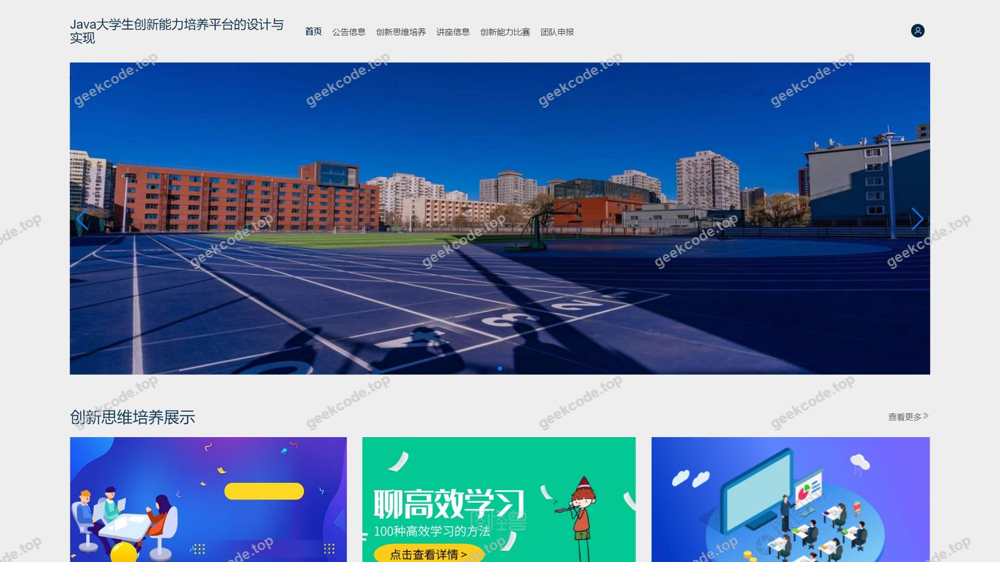</a>

<h4>前台-登录</h4>

<a href="https://geekcode.top/archives/springboot-Java%E5%A4%A7%E5%AD%A6%E7%94%9F%E5%88%9B%E6%96%B0%E8%83%BD%E5%8A%9B%E5%9F%B9%E5%85%BB%E5%B9%B3%E5%8F%B0%E7%9A%84%E8%AE%BE%E8%AE%A1?utm_source=github" title="查看完整源码">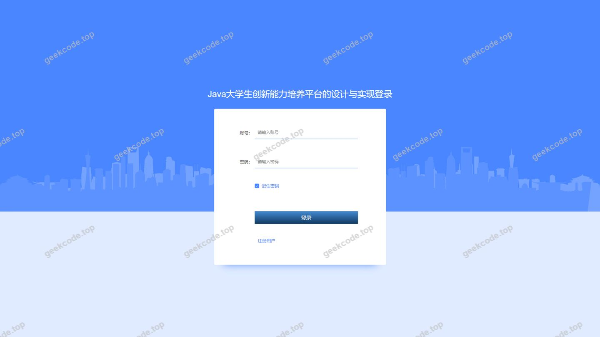</a>

<h4>前台-用户注册</h4>

<a href="https://geekcode.top/archives/springboot-Java%E5%A4%A7%E5%AD%A6%E7%94%9F%E5%88%9B%E6%96%B0%E8%83%BD%E5%8A%9B%E5%9F%B9%E5%85%BB%E5%B9%B3%E5%8F%B0%E7%9A%84%E8%AE%BE%E8%AE%A1?utm_source=github" title="查看完整源码">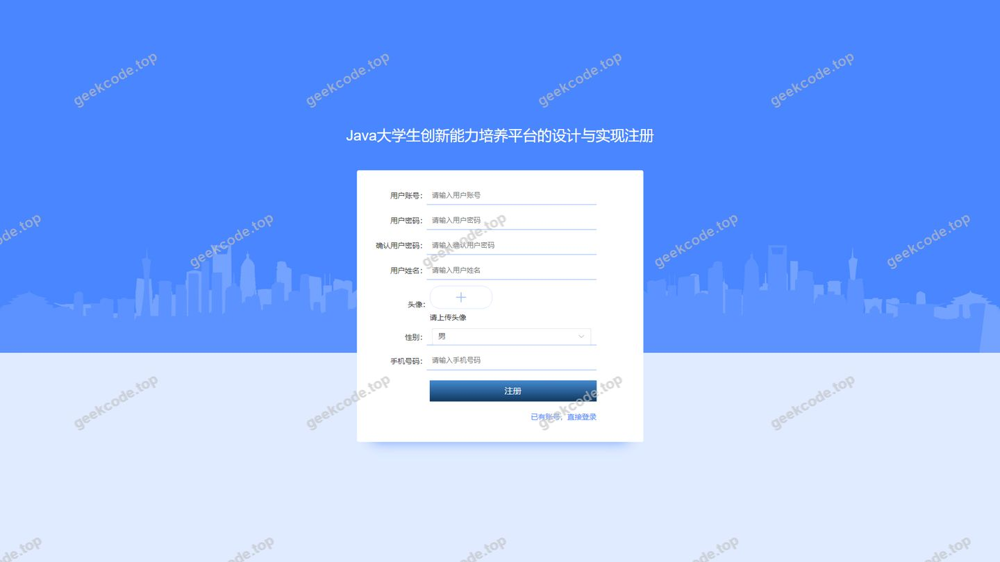</a>

<h3>后台管理端</h3>
<h4>后台-创新能力比赛</h4>

<a href="https://geekcode.top/archives/springboot-Java%E5%A4%A7%E5%AD%A6%E7%94%9F%E5%88%9B%E6%96%B0%E8%83%BD%E5%8A%9B%E5%9F%B9%E5%85%BB%E5%B9%B3%E5%8F%B0%E7%9A%84%E8%AE%BE%E8%AE%A1?utm_source=github" title="查看完整源码">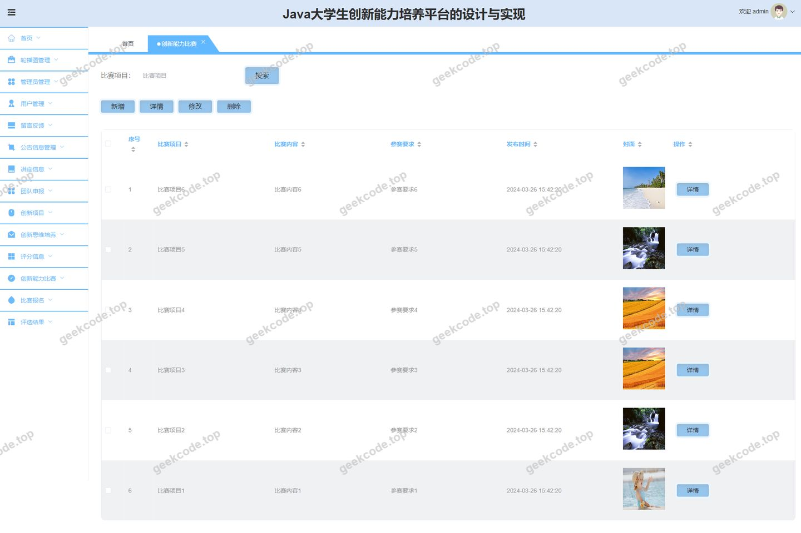</a>

<h4>后台-创新思维培养</h4>

<a href="https://geekcode.top/archives/springboot-Java%E5%A4%A7%E5%AD%A6%E7%94%9F%E5%88%9B%E6%96%B0%E8%83%BD%E5%8A%9B%E5%9F%B9%E5%85%BB%E5%B9%B3%E5%8F%B0%E7%9A%84%E8%AE%BE%E8%AE%A1?utm_source=github" title="查看完整源码">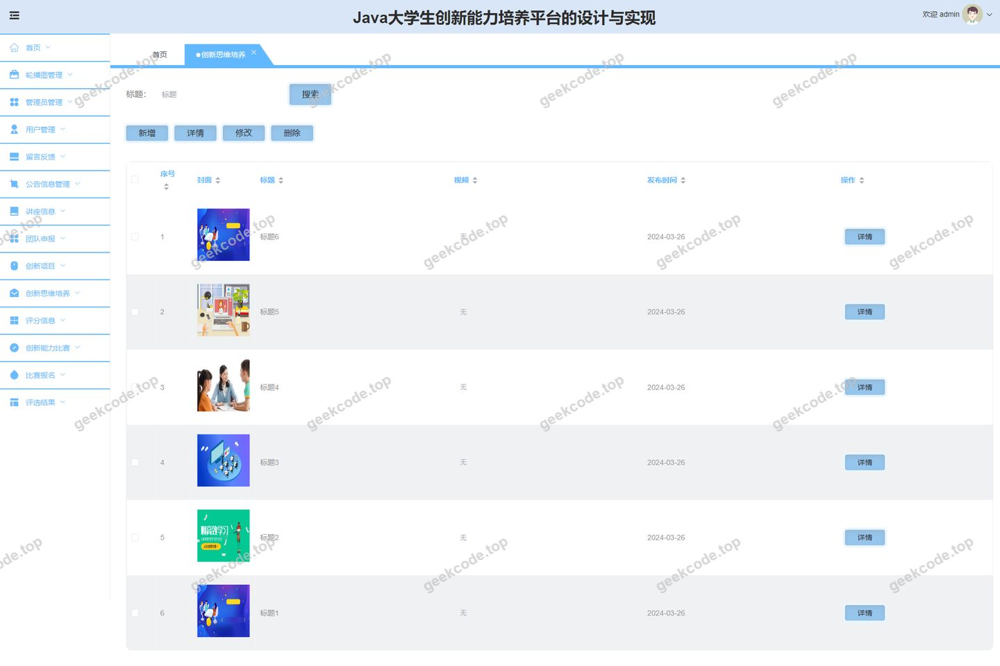</a>

<h4>后台-登录页</h4>

<a href="https://geekcode.top/archives/springboot-Java%E5%A4%A7%E5%AD%A6%E7%94%9F%E5%88%9B%E6%96%B0%E8%83%BD%E5%8A%9B%E5%9F%B9%E5%85%BB%E5%B9%B3%E5%8F%B0%E7%9A%84%E8%AE%BE%E8%AE%A1?utm_source=github" title="查看完整源码">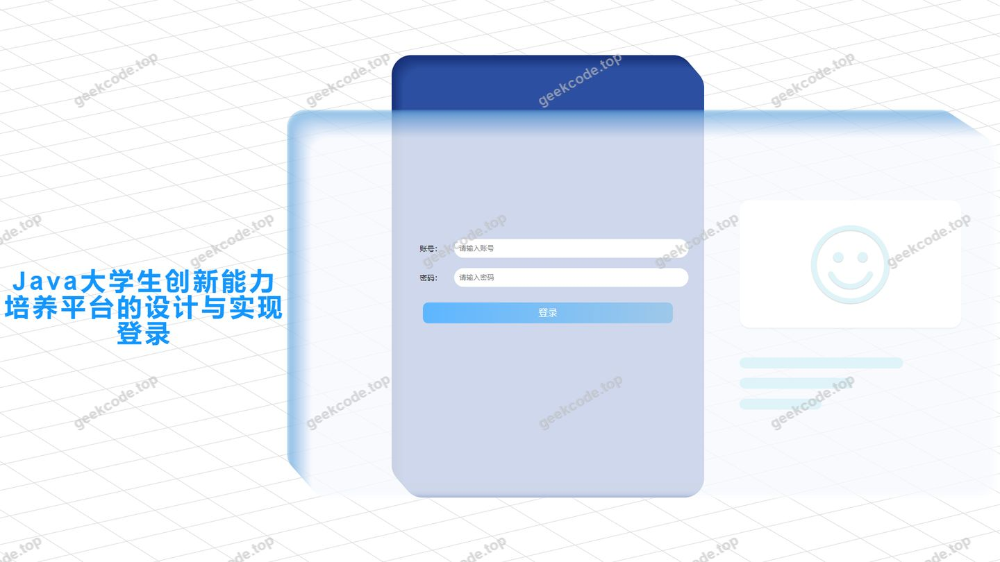</a>

<h4>后台-管理员</h4>

<a href="https://geekcode.top/archives/springboot-Java%E5%A4%A7%E5%AD%A6%E7%94%9F%E5%88%9B%E6%96%B0%E8%83%BD%E5%8A%9B%E5%9F%B9%E5%85%BB%E5%B9%B3%E5%8F%B0%E7%9A%84%E8%AE%BE%E8%AE%A1?utm_source=github" title="查看完整源码">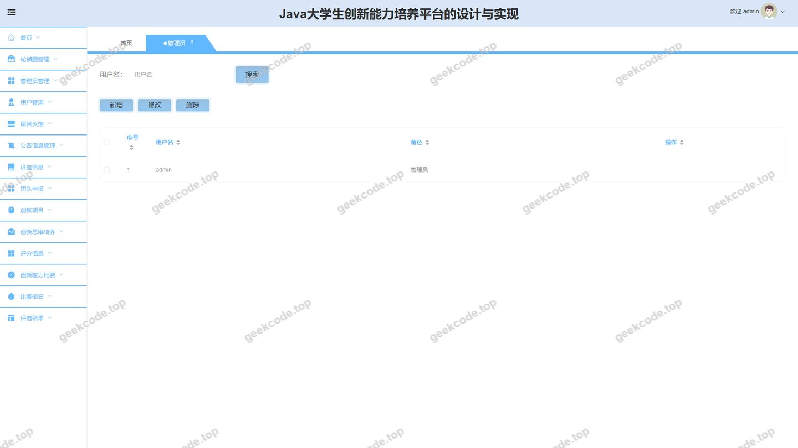</a>

<h4>后台-讲座信息</h4>

<a href="https://geekcode.top/archives/springboot-Java%E5%A4%A7%E5%AD%A6%E7%94%9F%E5%88%9B%E6%96%B0%E8%83%BD%E5%8A%9B%E5%9F%B9%E5%85%BB%E5%B9%B3%E5%8F%B0%E7%9A%84%E8%AE%BE%E8%AE%A1?utm_source=github" title="查看完整源码">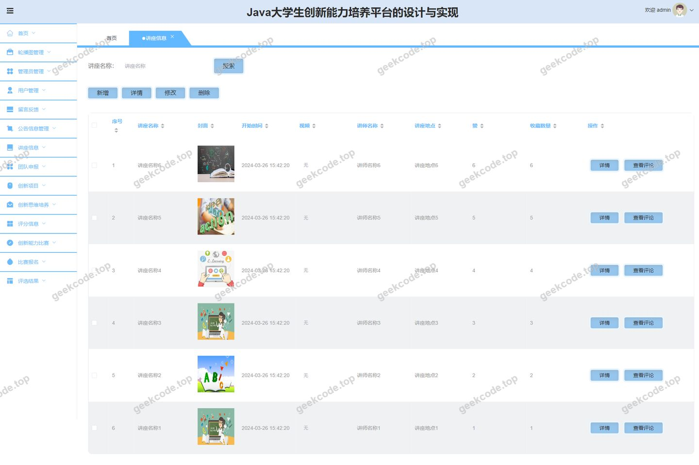</a>

<h4>页面-首页</h4>

<a href="https://geekcode.top/archives/springboot-Java%E5%A4%A7%E5%AD%A6%E7%94%9F%E5%88%9B%E6%96%B0%E8%83%BD%E5%8A%9B%E5%9F%B9%E5%85%BB%E5%B9%B3%E5%8F%B0%E7%9A%84%E8%AE%BE%E8%AE%A1?utm_source=github" title="查看完整源码">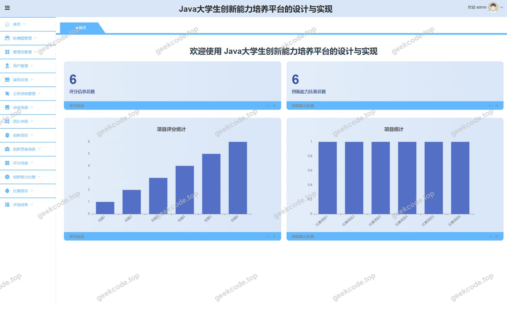</a>

<h4>后台-团队申报</h4>

<a href="https://geekcode.top/archives/springboot-Java%E5%A4%A7%E5%AD%A6%E7%94%9F%E5%88%9B%E6%96%B0%E8%83%BD%E5%8A%9B%E5%9F%B9%E5%85%BB%E5%B9%B3%E5%8F%B0%E7%9A%84%E8%AE%BE%E8%AE%A1?utm_source=github" title="查看完整源码">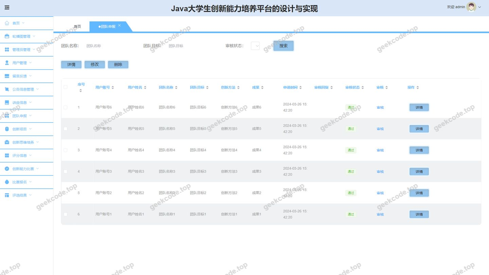</a>

<h4>后台-我的收藏</h4>

<a href="https://geekcode.top/archives/springboot-Java%E5%A4%A7%E5%AD%A6%E7%94%9F%E5%88%9B%E6%96%B0%E8%83%BD%E5%8A%9B%E5%9F%B9%E5%85%BB%E5%B9%B3%E5%8F%B0%E7%9A%84%E8%AE%BE%E8%AE%A1?utm_source=github" title="查看完整源码">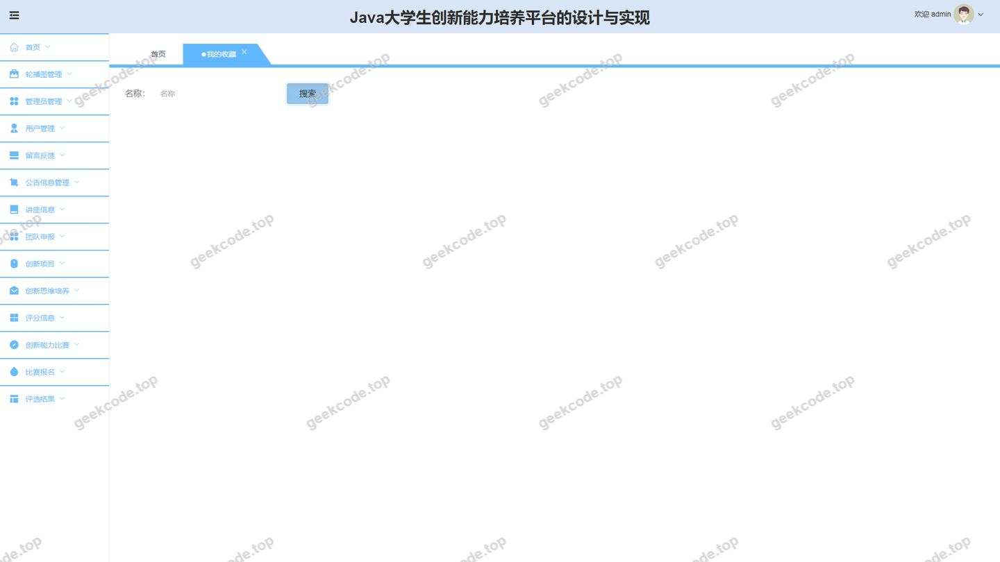</a>

---

## 获取完整源码

| 项目 | 说明 |
| --- | --- |
| 项目名 | [springboot]Java大学生创新能力培养平台的设计 |
| 运行截图 | 本文 11 张（站点带水印原图，仓库 `images/` 目录） |
| 完整源码 | [https://geekcode.top/archives/springboot-Java%E5%A4%A7%E5%AD%A6%E7%94%9F%E5%88%9B%E6%96%B0%E8%83%BD%E5%8A%9B%E5%9F%B9%E5%85%BB%E5%B9%B3%E5%8F%B0%E7%9A%84%E8%AE%BE%E8%AE%A1?utm_source=github](https://geekcode.top/archives/springboot-Java%E5%A4%A7%E5%AD%A6%E7%94%9F%E5%88%9B%E6%96%B0%E8%83%BD%E5%8A%9B%E5%9F%B9%E5%85%BB%E5%B9%B3%E5%8F%B0%E7%9A%84%E8%AE%BE%E8%AE%A1?utm_source=github) |
| 咨询微信 | **ir9372**（备注：jingpin-yuanma） |
| 更多项目 | [极客代码 geekcode.top](https://geekcode.top/?utm_source=github) |

> 需要源码、部署、改配置、跑不起来等问题，加微信 ir9372 沟通，说明项目名即可。
